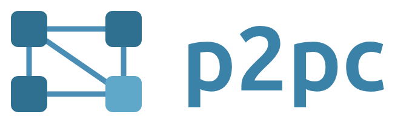
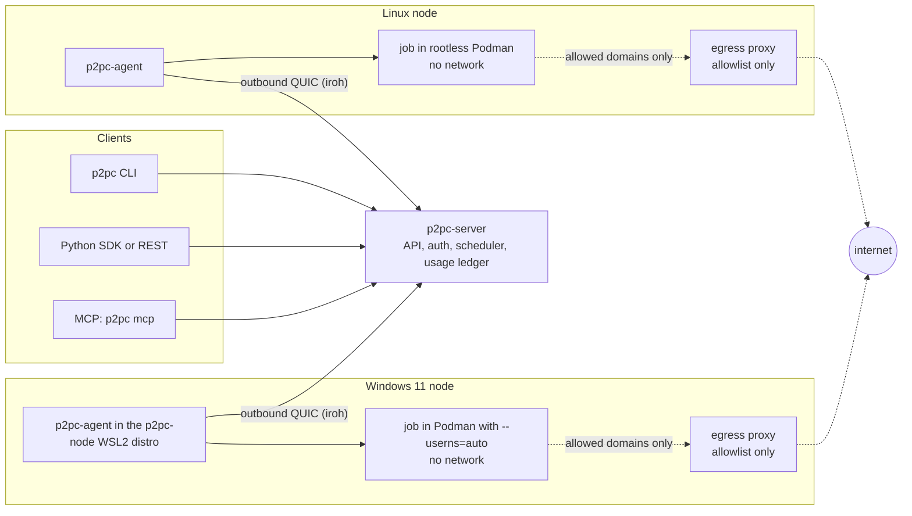

<p align="center">
  
</p>

<p align="center"><strong>Run containerized batch jobs on your own Linux and Windows machines, CPU and GPU, through one
API.</strong></p>

<p align="center">
  <a href="LICENSES/Apache-2.0.txt"></a>
  <a href="LICENSES/AGPL-3.0-only.txt"></a>
  
</p>

> **Status: preview (v0.1).** Jobs run only on machines you own. Not production-ready; releases before 1.0 can
> break compatibility. No marketplace and no payments.

## Overview

P2PC schedules batch jobs across a pool of machines you own. A job is an OCI image, a command and a resource request
(CPU, memory, GPU, disk and time). The server places it on a node with free capacity; the node's agent runs it in a
sandbox and returns its live log, its exit code and its output files.

- **Clients:** the `p2pc` CLI, a REST API ([OpenAPI](docs/api/openapi.json)), a Python SDK, and an MCP server for AI
  agents.
- **Scheduling:** best-fit placement with a queue. A job whose node is lost is retried on another node (once, by
  default).
- **Nodes:** Linux with rootless Podman, and Windows 11 with a dedicated WSL2 distro. NVIDIA GPUs through CDI on both.
- **Isolation:** each job runs in a sandbox with no network. Domains a job requests are reached through the node's
  allowlist proxy, which refuses private ranges: jobs cannot reach the LAN, the host or the tailnet.
- **Networking:** nodes connect outbound over QUIC (iroh) and open no ports, so they work behind NAT. Tested on home
  networks so far.
- **Access control:** scoped API keys with an optional expiry, daily compute cap and image allowlist; single-use,
  expiring join tokens. No telemetry.

## Architecture



- **The server** (`p2pc-server`) is the control plane: one process on one always-on Linux machine, with SQLite. Its REST
  API listens on `127.0.0.1` only. Clients elsewhere reach it through its **server address** (`p2pc_srv_…`), over an
  end-to-end encrypted iroh tunnel, with no open port.
- **The agents** (`p2pc-agent`) run on your machines and always dial the server: nodes never listen on the network.
- **Every job runs in a sandbox:** rootless Podman on Linux, a dedicated WSL2 distro on Windows (root inside it, with
  `--userns=auto`). All capabilities dropped, `no-new-privileges`, the default seccomp profile, and limits on CPU,
  memory, PIDs, disk and time. No host paths except the job's own scratch directories (`/inputs`, `/outputs` and the
  agent's helper directory), and never the Podman socket.
- **Egress goes only through the agent's proxy,** and only to the domains the job asked for. The proxy resolves DNS
  itself and always refuses loopback, private ranges, CGNAT (Tailscale included), link-local addresses and the host.

API keys have scopes, and can have an expiry, a daily cap and an image allowlist; the server stores only their hashes.
Join tokens are single-use and expire. There is no telemetry. By default the machines meet through n0's public iroh
relays, which see only node IDs, timing and sizes (set `relays` to use your own). The details and the known gaps are in
[`SECURITY.md`](SECURITY.md), [`docs/security/residual-risks.md`](docs/security/residual-risks.md) and the
[spec](docs/specs/H1-personal-cloud.md).

## Quick start

You need one always-on Linux machine for the server, and at least one machine to run jobs: a Linux machine with
rootless Podman, or a Windows 11 PC with WSL2 (see [Requirements](#requirements-and-supported-platforms)). Every
command below is documented in [`docs/cli.md`](docs/cli.md) and [`deploy/README.md`](deploy/README.md), with every
option.

**Placeholders.** `<server>` is your server's address, `p2pc_srv_…`, which the installer prints. `p2pc_sk_…` is an API
key and `p2pc_join_…` is a join token. Replace them with your own values. **Never put a key or a token on a command
line**: every command here reads them from a hidden prompt or from stdin.

### 1. Download and verify

The release is on the [releases page](https://github.com/Harold15000/p2pc/releases). On each Linux machine (the server
and every Linux node), download the Linux files into one directory and check them:

```sh
mkdir p2pc-0.1.0 && cd p2pc-0.1.0
base=https://github.com/Harold15000/p2pc/releases/download/v0.1.0
for f in SHA256SUMS install-server.sh install-node.sh setup-host.sh p2pc-server.service p2pc-agent.service \
         p2pc-0.1.0-x86_64-unknown-linux-musl.tar.gz p2pc-server-0.1.0-x86_64-unknown-linux-musl.tar.gz \
         p2pc-agent-0.1.0-x86_64-unknown-linux-musl.tar.gz p2pc-shim-0.1.0-x86_64-unknown-linux-musl.tar.gz; do
    curl -fLO "$base/$f" || { echo "DOWNLOAD FAILED: $f" >&2; break; }
done
sha256sum -c --ignore-missing SHA256SUMS
cd ..
```

```
install-node.sh: OK
install-server.sh: OK
…
```

Every line must say `OK`. `--ignore-missing` skips the files you did not download (the SBOMs in `sbom/`). This
catches a broken or truncated download; the installers check every file they use against `SHA256SUMS` again.

### 2. Install the server

On the server machine, as root:

```sh
sudo sh p2pc-0.1.0/install-server.sh --from p2pc-0.1.0
```

It installs `p2pc-server` and `p2pc` as a hardened systemd service and waits for `GET /healthz`. You see the admin key
**once**, between two lines of dashes, then a summary (shortened here with `…`):

```
…
The ADMIN API KEY below is shown ONCE. Copy it now into a password manager.
--------------------------------------------------------------------------------
Initialised /var/lib/p2pc-server
Config: /var/lib/p2pc-server/server.toml
ADMIN API KEY (shown once): p2pc_sk_…
SERVER ADDRESS: p2pc_srv_…
--------------------------------------------------------------------------------
==> Service p2pc-server
    healthy: http://127.0.0.1:7477/healthz

P2PC server 0.1.0 is running (…).
…
```

Copy the `p2pc_sk_…` key into a password manager. It is never shown again: the server stores only its hash. (Lost every
admin key? See `keys recover` in [`deploy/README.md`](deploy/README.md#2-install-one-command-on-the-server).) The
`SERVER ADDRESS` is the `<server>` of the next steps. It is not a secret, but every request still needs a key.

Installing from a script, CI or an agent, with no terminal? Add `--admin-key-file K` (K a new path in a private
directory): the key goes to K, mode 0600, instead of the screen. See "Scripted or CI install" in
[`deploy/README.md`](deploy/README.md#scripted-or-ci-install-no-terminal).

### 3. Log in

On the server machine, `p2pc` is already in `/usr/local/bin`: log in with the local URL. On a Linux laptop, download
and check `SHA256SUMS` and `p2pc-0.1.0-x86_64-unknown-linux-musl.tar.gz` as in step 1, then install `p2pc` from it; on
other systems, [build it from source](#build-from-source).

```sh
tar -xzf p2pc-0.1.0/p2pc-0.1.0-x86_64-unknown-linux-musl.tar.gz
sudo install -m 0755 p2pc-0.1.0-x86_64-unknown-linux-musl/p2pc /usr/local/bin/p2pc     # laptop only
```

```sh
p2pc login --server http://127.0.0.1:7477      # on the server machine; paste the key when asked (hidden)
p2pc login --server <server>                   # anywhere else, through the tunnel
```

```
Logged in to p2pc_srv_… (profile "default").
…
```

`p2pc login` checks the key with the server before it stores it in `credentials.toml` (mode 0600). In a script, pipe
the key in with `--key-stdin` from a secret store instead of the prompt.

The admin key has **no cap and no expiry**. Reserve it for administration; give scripts and agents their own capped
keys (`p2pc keys create`, below).

### 4. Join a Linux node

Create a single-use join token (it expires after 15 minutes):

```sh
p2pc join-token create --label spare-pc
```

```
Join token (single use, expires 2026-11-05T12:15:00Z):
  p2pc_join_…
…
```

The node needs systemd, Podman 4.9 or newer, `crun`, and cgroup v2 with `cpu`, `memory` and `pids` delegated. For a
GPU, install the NVIDIA driver and `nvidia-ctk` first. To see what is missing without changing anything (no root
needed):

```sh
bash p2pc-0.1.0/setup-host.sh --check-only
```

Then install, and paste the token when asked:

```sh
sudo sh p2pc-0.1.0/install-node.sh --from p2pc-0.1.0                # paste the token when asked (hidden)
sudo sh p2pc-0.1.0/install-node.sh --from p2pc-0.1.0 < token.txt    # or from a file
```

For the file form, save only the token: `(umask 077; p2pc join-token create --token-only > token.txt)`, copy it to the
node over a private channel, and `shred -u token.txt` afterwards. The installer refuses a token given as an argument.

The installer runs `setup-host.sh` first, which **changes the host**: it creates the system user `p2pc`, gives it
subuid and subgid ranges and turns on linger. If the host is not ready, it stops with a list of `[TODO]` items and
"Nothing was enrolled": fix them and run the same command again. It ends with:

```
Joined: node_01J… on <server NodeId>
```

To undo it, see "How to remove it" in [`deploy/README.md`](deploy/README.md#how-to-remove-it).

### 5. Join a Windows 11 node

The node is a dedicated WSL2 distro named `p2pc-node`. It does not touch your other distros, your Windows drives or
`.wslconfig`. You need WSL 2.0 or newer, virtualization turned on in the firmware, and 20 GB free.

In PowerShell 5.1 or newer, as yourself, download the installer, the node image and the Windows checksum list:

```powershell
$base = "https://github.com/Harold15000/p2pc/releases/download/v0.1.0"
foreach ($f in "SHA256SUMS-windows", "install.ps1", "p2pc-node-0.2.2.tar.gz", "p2pc-node-0.2.2.tar.gz.sha256") {
    curl.exe -fLO "$base/$f"
    if ($LASTEXITCODE -ne 0) { throw "DOWNLOAD FAILED: $f" }
}
```

The node image has its own version (0.2.2), apart from the release version (0.1.0). **Before you run anything**, check
`install.ps1` and the image against `SHA256SUMS-windows`. Each file must print `OK`; a mismatch stops with a red
error:

```powershell
foreach ($f in "install.ps1", "p2pc-node-0.2.2.tar.gz") {
    $want = foreach ($l in Get-Content .\SHA256SUMS-windows) {
        if ($l -match '^([0-9a-fA-F]{64}) [ *](.+)$' -and $Matches[2] -eq $f) { $Matches[1] }
    }
    $got = (Get-FileHash ".\$f" -Algorithm SHA256).Hash
    if (-not $want -or $got -ne $want) { throw "CHECKSUM MISMATCH (or not listed) for ${f}: do not use it" }
    "${f}: OK"
}
```

(`-ne` compares strings case-insensitively in PowerShell, so the lower-case hex of the list matches the upper-case
hex of `Get-FileHash`.) Windows blocks downloaded scripts by default. Once the checksum matches, allow local scripts
for this PowerShell window only and remove the download mark:

```powershell
Set-ExecutionPolicy -Scope Process -ExecutionPolicy RemoteSigned    # this PowerShell window only
Unblock-File .\install.ps1
```

Install the distro (it checks the image against its `.sha256` first), then join with a new token from
`p2pc join-token create`:

```powershell
.\install.ps1 -Tar .\p2pc-node-0.2.2.tar.gz
.\install.ps1 -Join                                  # paste the token when asked (hidden)
```

`-Join` registers and starts the scheduled task **"P2PC node"**, which keeps the agent running, and ends with
`Joined: <node> on <server NodeId>`. `.\install.ps1 -Status` shows the node later; `-Stop` and `-Start` take it offline
and back. Everything else (upgrade, uninstall, logs) is in [`deploy/README.md`](deploy/README.md#windows-wsl2).

### 6. Check your machines

```sh
p2pc machines
```

```
NAME      ID         STATE   PLATFORM  CPU FREE/OFFERED  RAM FREE/OFFERED  GPU FREE/OFFERED  LAST SEEN
spare-pc  node_01J…  online  linux     8/8               30 GiB/32 GiB     1/1               3s ago
```

Each machine should be `online`, with the CPU, RAM and GPU it offers (by default 75 % of its CPUs and RAM, and every
GPU; the share is set on the machine). `p2pc machines show <name>` has the details.

### 7. Run a CPU job and a GPU job

```sh
p2pc run --image docker.io/library/python:3.12-slim -- python -c "print(6*7)"
```

```
42
```

The job's own output goes to stdout; its ID and state changes go to stderr. The exit code of `p2pc run` is the job's.
The first run pulls the image, so it takes longer.

On a machine with an NVIDIA GPU:

```sh
p2pc run --image nvcr.io/nvidia/cuda:12.4.1-base-ubuntu22.04 --gpu 1 -- nvidia-smi
```

The output is the `nvidia-smi` table of the node's GPU. If no machine has a free GPU, the job waits in the queue;
`p2pc estimate` takes the same flags and reports whether a job can run.

A detached job, its live log and its output files (everything it writes to `/outputs`):

```sh
JOB=$(p2pc run -d --image docker.io/library/python:3.12-slim -- \
        sh -c 'for i in 1 2 3 4 5; do echo "$i"; sleep 1; done; echo 42 > /outputs/answer.txt')
p2pc logs --follow "$JOB"          # prints the lines as the job writes them; returns when the log ends
p2pc results "$JOB" --out ./out    # downloads /outputs into ./out, each file checked against its SHA-256
```

`Ctrl-C` on `p2pc run` or `p2pc logs --follow` stops following and **does not cancel** the job; `p2pc cancel "$JOB"`
does. A job has no network unless you pass `--egress pypi.org,files.pythonhosted.org` (or other domains).

## SDK and MCP

**Python SDK.** It is not on PyPI yet; install it from the release tag. The SDK talks to a URL, so for a server you
reach through its address, run `p2pc proxy` first (it serves `http://127.0.0.1:7477`). Do not use the admin key in
code: create a capped key, printed once on stdout, and paste it into a hidden prompt:

```sh
pip install "p2pc @ git+https://github.com/Harold15000/p2pc@v0.1.0#subdirectory=sdk/python"
p2pc keys create --label sdk --scope jobs:read --scope jobs:write --cap 5 --expires 30d    # copy the p2pc_sk_… key
p2pc proxy &                  # serves the tunnel on http://127.0.0.1:7477; not needed on the server machine
export P2PC_API_URL=http://127.0.0.1:7477
read -rs P2PC_API_KEY && export P2PC_API_KEY       # paste the new key, press Enter (hidden: not in your history)
```

Submit 100 jobs and print their output:

```python
import p2pc

client = p2pc.Client()  # reads P2PC_API_URL and P2PC_API_KEY
jobs = [
    client.jobs.run(
        image="docker.io/library/python:3.12-slim",
        command=["python", "-c", f"print({n}, sum(i * i for i in range({n} * 100_000)))"],
        timeout_s=120,  # the daily cap is charged cpu x timeout up front: keep it short
        idempotency_key=f"squares-{n}",  # running the script again returns the same jobs
    )
    for n in range(100)
]
for job in jobs:
    job = job.wait()
    print(job.status, "".join(line.data for line in job.logs()), end="")
```

More in [`sdk/python/README.md`](sdk/python/README.md). The REST API itself is described in
[`docs/api/openapi.json`](docs/api/openapi.json).

**MCP.** Create a separate key with a **daily cap** for the agent, store it as its own profile, and register the server.
By default, `p2pc mcp` refuses a key with the `admin` scope or without a cap:

```sh
p2pc keys create --label agent --scope jobs:write --scope jobs:read --scope nodes:read \
    --cap 5 --image 'docker.io/library/*' --expires 30d | p2pc login --profile agent --key-stdin --server <server>
claude mcp add p2pc -- p2pc mcp --profile agent
```

Example prompt: "Use p2pc to run `python -c 'print(6*7)'` in `python:3.12-slim` and report the output." `--cap 5` is
five compute units (vCPU-hours reserved) per UTC day. Revoke the key at any time with
`p2pc keys revoke <key id>`. Other MCP clients and every tool are in [`docs/mcp.md`](docs/mcp.md).

## Requirements and supported platforms

- **Tested end to end on real machines:** Ubuntu 24.04, an Arch-based distribution, and Windows 11 with WSL2, with
  NVIDIA GPUs on Linux and on WSL2.
- **Supported by the installers:** Ubuntu 22.04, 24.04 and 26.04, Debian 12 and 13, and Arch Linux (and distributions
  based on it). This list is covered by the installers' own tests, which run them with fake system commands. For a
  Linux node the distribution must also ship Podman ≥ 4.9 (Ubuntu 24.04+, Debian 13, Arch); on Ubuntu 22.04 and
  Debian 12 only the server works without a newer Podman. Any other Linux with systemd that meets the requirements
  gets one warning from the installer ("not a tested platform") and the install goes on.

| Role | Requirements |
|---|---|
| Server | x86_64 Linux with systemd |
| Linux node | x86_64, systemd, rootless Podman ≥ 4.9 with `crun`, cgroup v2 with `cpu`, `memory` and `pids` delegated |
| Windows node | Windows 11 with WSL 2.0 or newer, virtualization on, 20 GB free |
| GPU | NVIDIA, through CDI: the driver and `nvidia-ctk` on Linux; the Windows driver on WSL2 (the node image has the toolkit) |
| Client | `p2pc`: x86_64 Linux in the release, built from source elsewhere. The Python SDK: Python 3.11+ |

**No macOS nodes yet.** The release has no aarch64 binaries.

## Roadmap

Planned work, without dates; subject to change.

- **Next:** a desktop application to join machines and run jobs without the CLI; then teams (several users sharing
  one pool).
- **Under consideration:** running jobs for other users on spare capacity. It requires VM-level isolation first (see
  the limitations in [`CHANGELOG.md`](CHANGELOG.md)) and is not in development.

## Build from source

You need the Rust toolchain pinned in `rust-toolchain.toml`. To build only the CLI, for example for a laptop that is
not x86_64 Linux (the CLI is written for Linux, macOS and Windows, but CI builds and tests it on Linux only):

```sh
cargo build --release -p p2pc-cli          # target/release/p2pc
```

To build a whole release like the one on the releases page (static musl binaries, installers and `SHA256SUMS` in
`dist/0.1.0/`), and the Windows node image from it, follow [`deploy/README.md`](deploy/README.md):
"[Build the release](deploy/README.md#1-build-the-release-on-a-build-machine)" and
"[Build the image](deploy/README.md#1-build-the-image-on-a-linux-build-host-or-inside-an-ubuntu-wsl-distro-as-root)".

## Docs

- [`docs/cli.md`](docs/cli.md): every `p2pc` command, flag, exit code and output.
- [`deploy/README.md`](deploy/README.md): the installers, upgrades, backups, logs, troubleshooting and uninstall.
- [`sdk/python/README.md`](sdk/python/README.md): the Python SDK.
- [`docs/mcp.md`](docs/mcp.md): the MCP server for AI agents.
- [`docs/specs/H1-personal-cloud.md`](docs/specs/H1-personal-cloud.md): the v0.1 spec (architecture, protocol, sandbox).
- [`docs/security/residual-risks.md`](docs/security/residual-risks.md): the known security gaps.
- [`CHANGELOG.md`](CHANGELOG.md): what changed in each release.

## Contributing

Read [`CONTRIBUTING.md`](CONTRIBUTING.md) before opening a pull request: it sets the mandatory rules (sandbox, egress
and secrets), the checks to run and the review process. Commits must be signed off (`git commit -s`) under the
[Developer Certificate of Origin](CONTRIBUTING.md#developer-certificate-of-origin). Participation is subject to the
[Code of Conduct](CODE_OF_CONDUCT.md).

## Security

Report vulnerabilities privately through the repository's **Security** tab (**Report a vulnerability**), not in a
public issue. See [`SECURITY.md`](SECURITY.md).

## License

- The control plane, [`crates/p2pc-server`](crates/p2pc-server), is licensed under
  **[AGPL-3.0-only](LICENSES/AGPL-3.0-only.txt)**.
- Everything else (the agent, the CLI, the protocol and networking crates, the shim and the Python SDK) is licensed
  under **[Apache-2.0](LICENSES/Apache-2.0.txt)**.

Each crate declares its license in its `Cargo.toml`, and every source file carries an SPDX header.
